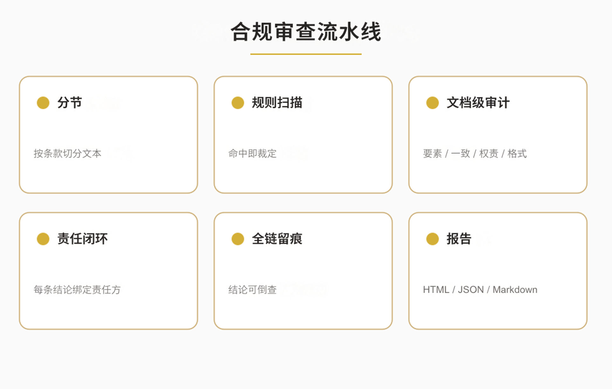
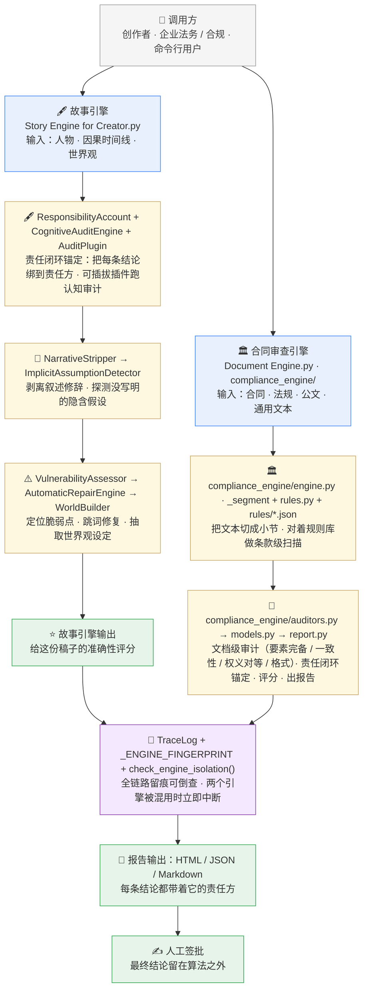

<p align="center">
  
</p>

<p align="center">
  
  
  
  
  
</p>

<blockquote align="center">
  <em>一个仓库 · 两个引擎 —— 故事引擎 与 合同审查引擎</em>
</blockquote>

<p align="center">
  <a href="README.md">English</a> | 简体中文
</p>

<div style="max-width:880px;margin:0 auto;padding:0 16px">

## ✦ 关于

<p style="font-size:15px;line-height:1.8;color:#2C2C2C">STORY-ENGINE 是<strong>一个仓库里的两个引擎</strong>，各自独立、可分别运行，共用同一套确定性审计语法：</p>

<ul style="font-size:15px;line-height:1.8;color:#2C2C2C">
  <li><strong>故事引擎（Story Engine）</strong> —— 面向创作者与大众的长篇小说一致性引擎。自动审计人物设定、因果时间线与记忆线，使百万字作品在人物、情节与世界观上保持一致；同时提供 SPL 四阶段叙事编辑流水线。它把编辑的直觉式校对转化为可复用的结构化流程。</li>
  <li><strong>合同审查引擎（Document Review Engine）</strong> —— 面向企业法务 / 合规的文档复核引擎。对合同、法规、公文与通用文本执行条款级规则扫描与文档级审计（要素完整性 / 一致性 / 权责对等 / 格式），并输出可追溯的复核报告。<strong>规则内核零依赖、可完全离线运行</strong>；`Document Engine.py` 提供可选的 LLM 增强入口。</li>
</ul>

<p align="center">
  
</p>

</div>

<p align="center">— ✦ —</p>

## ✦ 系统架构（人话版）

> **一句话：** 一个仓库，两个引擎——一个让百万字长篇不自相矛盾，一个让企业文档保持合规。两者共用同一套审计语法，但数据类互相隔离。



**这张图怎么看**

1. **从上往下：两个入口，一条脊柱。** 调用方分别进入故事引擎与合同审查引擎两条支线，每条支线最后都汇入同一套留痕层，产出同样三种格式的报告。
2. **每个框都写了真实文件或类名。** `Story Engine for Creator.py`、`Document Engine.py`、`compliance_engine/engine.py`、`auditors.py`、`models.py`、`report.py`——可以对照源码直接翻。
3. **合同审查引擎是最硬的边界。** 它的规则内核完全不依赖大模型：纯 JSON 规则库（`rules/*.json`），可离线运行，命中即判、结果确定。`Document Engine.py` 只是可选的 LLM 增强层，不接入也能完整跑通。

📖 每个术语都用一句人话解释 → [术语表 GLOSSARY](./GLOSSARY.md)

## ✦ 设计方向

<div style="max-width:880px;margin:0 auto;padding:0 16px">

一个仓库，两个引擎，各自面向不同用户群体：

| 引擎 | 目标用户 | 模块 | 典型输入 |
|---|---|---|---|
| **故事引擎** | 创作者 / 大众 | `Story Engine for Creator.py` · `prose_bridge.py` · `shuihu_llm_audit.py` | 人物 / 因果时间线 / 世界观 / 叙事要素 |
| **合同审查引擎** | 企业法务 / 合规 | `compliance_engine/`（规则内核，离线零依赖）+ `Document Engine.py`（可选 LLM 增强） | 合同 / 法规 / 公文 / 通用文本 |

两个引擎共享同一套**确定性审计设计语言** —— 责任闭环锚定（`ResponsibilityAccount`）、风险分级与全链可追溯日志。合同审查引擎的规则内核**不依赖 LLM** —— 纯规则库、零第三方依赖、离线运行，专攻企业文档合规场景。

</div>

<p align="center">— ✦ —</p>

## ✦ 快速开始

```bash
# 主仓库：GitHub
git clone https://github.com/nohn3043-arch/story-engine.git
# 镜像：Gitee
# git clone https://gitee.com/sjiun/Story-engine.git
cd Story-engine
# 纯 Python >=3.8。引擎文件有意使用带空格的文件名。

# ── 引擎一：故事引擎 ──
cd story-engine
python "Story Engine for Creator.py"      # 长篇叙事一致性审计

# ── 引擎二：合同审查引擎 ──
cd ../document-engine
python -m compliance_engine audit --type contract --input 合同.txt --output 报告.html
python -m compliance_engine audit --type regulation --input 制度.txt --format json
python -m compliance_engine list-rules --type contract
python -m compliance_engine demo
```

<p align="center">— ✦ —</p>

## ✦ 功能特性

<div style="max-width:880px;margin:0 auto;padding:0 16px">

一个仓库，两个引擎，各自服务不同用户群体：

### 引擎一 · 故事引擎（面向创作者与大众）

一个长篇小说一致性引擎，把编辑的直觉式校对转化为可复用的结构化流程：

- **创作者引擎**（`Story Engine for Creator.py`）—— 面向叙事的认知审计层：
  - `ResponsibilityAccount` —— 每项检查都锚定到具名的责任节点（谁 / 角色 / 阶段）。
  - `CognitiveAuditEngine` + 可插拔 `AuditPlugin` + `EmotionalConstraint` —— 可组合的审计维度。
  - `CausalNode` 携带 `implicit_assumptions` 与 `vulnerability_score` —— 追踪*因为 → 所以*逻辑并量化脆弱性。
  - `NarrativeStripper` / `ImplicitAssumptionDetector` / `VulnerabilityAssessor` —— 第二视角算子流水线。
  - `AutomaticRepairEngine`（全量跳词修复）/ `UltimateCausalNovelEngine` / `SecondPerspectiveCausalEngine` / `WorldBuilder`（词元级世界观提取）—— 修复、全书审计与世界观构建层。
- **叙事桥接**（`prose_bridge.py`）与**语料审计**（`corpus_fetch.py` / `corpus_audit_report.py` / `shuihu_llm_audit.py`）—— 生成层与批量语料核验层。

### 引擎二 · 合同审查引擎（面向企业法务 / 合规）

一款企业级文档合规复核引擎，由两部分组成：

- **规则内核**（`compliance_engine/`）—— 零依赖、离线运行：
  - 支持对四类文档（合同 / 法规 / 公文 / 通用文本）执行条款级规则扫描 + 文档级审计（要素完整性 / 一致性 / 权责对等 / 格式）。
  - `ComplianceEngine` 编排：分节 → 规则扫描 → 文档级审计 → 责任闭环 → 评分 → 报告。
  - `ResponsibilityAccount` 责任闭环锚定 + `TraceLog` 全链可追溯；判定为确定性（命中即裁定），无概率输出。
  - `RuleEngine` 加载纯 JSON 规则库（可经 `--rules-dir` 外部扩展）；四个 `Auditor` 类补充条款级命中。
  - 报告支持三种格式：HTML（可视化）/ JSON（结构化）/ Markdown（归档）；完整 CLI：`audit` / `list-rules` / `demo`。
- **LLM 增强入口**（`Document Engine.py`）—— 可选层：
  - 定义 `LLMProvider` 协议，任何实现该协议的类都可注入引擎。
  - 自带 `OpenAIProvider`：用 `urllib` 调用 OpenAI 兼容接口（`gpt-4o` / `deepseek-chat` 等），**零外部依赖**。
  - 不配置任何 LLM 时，规则内核独立完整运行。

两个引擎共享同一套确定性审计设计语言（责任闭环锚定、风险分级、全链可追溯），但分别面向创作叙事与企业文档场景。

**健壮性加固（2026-08 修复）**：

- **人名合理性过滤** —— `_extract_plausible_name` 排除代词 / 动词短语 / 天气场景词，宁可缺失也不要噪声：`"坚持己见" → ""`，`"他说：我们走吧" → ""`，`"林夏在评审会上坚持自研方案" → "林夏"`。
- **词元级世界观提取** —— `WorldBuilder` 先按连接词 / 标点预分词，再以最长后缀优先匹配整词：`"青云宗与魔道势力在苍云大陆" → factions ["青云宗","魔道势力"], geography ["苍云大陆"]`，连接词不再被吞并。
- **全文修订替换** —— `AutomaticRepairEngine` 一次性替换所有生硬过渡词（`突然 / 莫名 / 鬼使神差 …`），并合并相邻的重复过渡短语。
- **引擎隔离检测** —— 两个引擎都内嵌 `_ENGINE_FINGERPRINT` 与 `check_engine_isolation()`：在同一进程中混用会立即告警，防止同名但异质的数据类（`CausalNode` / `ResponsibilityAccount` 等）互相覆盖导致的数据损坏与崩溃。

</div>

<p align="center">— ✦ —</p>

## ✦ 使用方法

<div style="max-width:880px;margin:0 auto;padding:0 16px">

合同审查引擎的规则内核可直接以库方式调用：

```python
from compliance_engine.engine import ComplianceEngine
from compliance_engine.models import DocType
from compliance_engine.report import to_html, to_json, to_markdown

engine = ComplianceEngine()                      # 默认加载内置 rules/*.json
report = engine.audit(open("合同.txt", encoding="utf-8").read(), DocType.CONTRACT, title="采购合同")
print(to_json(report))
```

也可以换外部规则库：`ComplianceEngine(rules_dir=Path("my-rules"))`，或用 `--rules-dir` 从 CLI 指定。

需要 LLM 增强时，实现 `Document Engine.py` 里的 `LLMProvider` 协议并注入即可；不注入则完全离线运行。

</div>

<p align="center">— ✦ —</p>

## ✦ 项目结构

```
STORY-ENGINE/
├── story-engine/                  # 引擎一 · 故事引擎（长篇叙事一致性审计）
│   ├── Story Engine for Creator.py
│   ├── prose_bridge.py            # 叙事桥接 / 生成层
│   ├── hlm_audit.py               # 语料审计运行器（红楼梦全书 120 回，哈希链存证）
│   ├── foreshadow_arc.py          # 伏笔对账 + 判词谶语解析（独立模块，不依赖引擎）
│   ├── detect_logic_gaps.py       # 逻辑漏洞检测编排器（EventNode → 四校验器 → 责任锚定 → 报告）
│   ├── logic_validators.py        # 四类结构化逻辑校验器（语言无关、确定性、零依赖）
│   ├── extraction/                # 上游抽取层（散文 → EventNode，契约与校验层解耦）
│   │   ├── schema.py              # EventNode 契约（抽取层与校验层的唯一接口）
│   │   ├── rule_extractor.py      # 零依赖规则抽取（白盒验收基线 / 降级兜底）
│   │   └── lexicons/              # 语料词表（红楼梦 / 水浒最小集）；换语料 = 换词表，不改代码
│   ├── adapters/                  # 语言适配层（协议见 spec.md）
│   │   ├── spec.md                # 语言包协议（六方法 + 部署约束 + 已知边界）
│   │   └── zh.py                  # 中文参考实现（45 类语言常量 + 六方法）
│   ├── golden_samples.json        # 白盒验收样本（水浒 007/010/016 回）
│   ├── audit_postprocess.py       # LLM 审计发现后处理（去重聚类 + 自洽校验）
│   ├── shuihu_llm_audit.py        # 语料审计（LLM 辅助）
│   ├── corpus_fetch.py            # 语料抓取
│   ├── corpus_audit_report.py     # 语料审计报告
│   ├── shuihu_builtin_audit_sample.md  # 内置审计样例
│   ├── corpus/                    # 本地语料（git 忽略）
│   └── corpus_audit/              # 审计产物（git 忽略）
├── document-engine/               # 引擎二 · 合同审查引擎
│   ├── Document Engine.py         # LLM 增强入口（LLMProvider 协议 + OpenAIProvider）
│   ├── compliance_engine/         # 规则内核（离线、零依赖）
│   │   ├── engine.py / models.py / auditors.py / rules.py / report.py
│   │   ├── cli.py                 # audit / list-rules / demo
│   │   ├── rules/                 # contract.json / regulation.json / official_doc.json / common.json
│   │   └── demo.py
│   └── demo_output/               # 演示产物（git 忽略）
├── assets/                        # banner.svg/png、overview.svg/png
├── GLOSSARY.md                    # 术语表
├── LICENSE
└── README-zh.md
```

<p align="center">— ✦ —</p>

## ✦ 语料依赖（clone 后需自备）

`corpus/` 与 `corpus_audit/` **不在版本控制内**（`.gitignore` 忽略）。因此：

- `hlm_audit.py`、`foreshadow_arc.py`、`detect_logic_gaps.py`、`shuihu_llm_audit.py`、`corpus_fetch.py` 等语料工具，clone 后**不带语料**，需自备 `corpus/<书名>/NNN 第N回 <回目>.txt`（三位回号前缀 + 空格 + 回目）才能运行；
- 引擎本体 `Story Engine for Creator.py` **不依赖语料**可独立运行，但**必须与 `adapters/` 目录同级部署**——适配器缺失时启动即报错，不做静默回退；
- 红楼梦审计的结论与逐回数据存放在本机 `corpus_audit/`，不在仓库内，需另行获取。

<p align="center">— ✦ —</p>

## ✦ 适用边界（基于实测，非设计目标声明）

以下结论来自本仓 **红楼梦 120 回全量 + 四大名著 + 工作区 5 份现代中文文档** 的实测，可复现、可回原文核验。

### 已验证可用

| 文体 / 场景 | 状态 | 实测依据 |
|---|---|---|
| 明清章回小说（古白话、半文半白） | ✅ 可用 | 四大名著风格族全部正确路由 `eastern_ancient`；红楼梦 120 回全量可跑，悬空节点 0，审计链 120 块 0 断点 |
| 全知说书人叙事 | ✅ 可用 | `narration_mode="omniscient"` 下叙事立场审计 0 误报（默认 `chronicler` 会把「原来」「殊不知」误判为全知解说腔） |
| 长篇群像（人物 50+） | ✅ 可用 | 红楼梦 206 项角色词表 + 16 组别称下说话人归属正常；**不注入词表时角色归属不可信** |
| 文风一致性度量 | ✅ 可用 | `prose_style` 七项指标在 `eastern_ancient` 族下可复现（句长 / 虚字密度 / 节奏变异 / tell 密度 / 视角头跳 / 近距复用 / 语域） |

### 已验证不可用（勿用于此类文本）

| 文体 / 场景 | 状态 | 实测依据 |
|---|---|---|
| 现代中文小说（都市 / 网文 / 科幻） | ❌ 误判 | 工作区 5 份现代中文文档 **5/5 被判古典族**（4×`eastern_ancient`、1×`classical_poetry`） |
| 现代说明文 / 技术文档 / 公文 | ❌ 误判 | 同上 |
| 英文及非中文 | ❌ 无实现 | `adapters/` 仅有中文参考实现；跨语言**无语料、无验收**，协议就绪 ≠ 能力就绪 |
| 短篇（< 300 汉字） | ⚠️ 检测器跳过 | 句数不足，节奏 / tell 密度等返回「样本不足」 |

**误判根因（已定位，未修复）**：风格族判定用的「文言虚字计数」特征**无判别力**——现代中文的「之 / 于 / 以 / 而 / 其 / 者」（之后、于是、以及、而且、其中）与文言虚字同形，实测现代文档密度 **23.4‰** 反而**高于**红楼梦 **20.65‰**；句长亦重叠（现代长句 23–33 ≈ 红楼梦 20）。

### 名义有能力、实测未产出（**勿当作已交付**）

| 功能 | 实际情况 |
|---|---|
| 台词认知审计（`forbidden_knowledge`） | 需角色知识模型；未配置即跳过。红楼梦实测 0 issues 属「未启用」，**不是「无问题」** |
| 台词语域审计（`register_hints`） | 同上 |
| 伏笔台账 | 引擎内关键词路径仅识别「埋下 / 回收」类元语言关键词，红楼梦正文不用此类语，实测 set/pay = **0**；新流水线 `logic_validators.audit_foreshadow_gap` 需抽取层给出显式 SET/PAY 标记，规则路径同样为 0 |
| 时空校验 | 已有专用流水线（`extraction/` → `logic_validators.py`），但**规则抽取完整坐标率实测 0.1%**（红楼梦 120 回 21,439 节点），时空/时间线校验在规则路径下无可判输入；LLM 抽取路径接口已留、端点未接通 |
| 因果五步算子 | 大纲式输入（`A -> B`）才有意义；直接喂整段散文会退化为逐句拆解 |
| 哈希链存证 | **非确定性缺陷已修复**（2026-10）：`_strip_nondeterminism` 在入哈希前剥离 uuid 派生字段，实测「同内容同哈希 ✅ / 内容敏感 ✅」；残余限制 = 仅防随机字段扰动，不防恶意同哈希构造 |
| LLM 深诊 | 需自备 OpenAI 兼容端点 key；不注入则降级为纯规则 |

### 逻辑漏洞检测流水线（2026-10 新增，实测边界）

`detect_logic_gaps.py` + `logic_validators.py` + `extraction/` 构成「散文 → EventNode → 四校验器 → 责任锚定 → 报告」流水线，四校验器：时空冲突、死而复生（按行文顺序）、时间倒退（同章）、伏笔未回收。均遵循宁缺毋滥：坐标缺失即跳过。

| 项 | 实测值（红楼梦 120 回） |
|---|---|
| 抽取节点 / 角色 | 21,439 / 66（词表覆盖） |
| time / place / 完整坐标覆盖率 | 6.1% / 1.0% / **0.1%** |
| state 覆盖率（死/生） | 25.7%（5 / 5,511） |
| 冲突检出 | **0**（瓶颈在上游抽取层，非校验器） |
| 死亡节点准确率（回原文核验） | 4/4 |
| 白盒验收 | 首轮 31 条候选逐条回原文核验，0 真漏洞；归纳 12 类假阳性全部规则化，复跑 0 冲突 |
| 黄金样本复测（水浒 007/010/016） | 修复前 1 条诗句 FP → 修复后 0 冲突 |

**已知盲区**：非词汇化死亡漏检（晴雯 ch77、凤姐 ch114 幕后追述、尤三姐 ch66 全文无死亡词汇）；亲属称谓指代无法归属（「長孫媳婦」「妹子」）；鬼魂显灵误触死→生校验（须人工复核）；判词-vs-正文矛盾不属四校验器覆盖类（由 `foreshadow_arc.py` 产出，红楼梦已确证 3 条）。

**后续路径**：① LLM 抽取层（接口已留）攻击 0.1% 覆盖率瓶颈；② 第五类校验器「谶语-正文对账」并入编排器；③ 词表补亲属称谓映射与死亡词汇。

### 使用前提（三条，缺一则结论不可信）

1. **角色词表**（`known_names` / `characters`）是因果层可用的前提；不提供则角色归属与悬空判定不可信。
2. **叙事立场**需显式指定；默认 `chronicler` 适用于史官旁观，古白话长篇小说应传 `omniscient`。
3. 引擎文件必须与 `adapters/` 目录**同级部署**，适配器缺失时启动即报错（不做静默回退）。


<p align="center">— ✦ —</p>

## ✦ 许可与授权

本仓库**并非开源**，采用双轨模式：个人非商业研究免费；政府 / 企业需付费商业许可。详见 [LICENSE](./LICENSE)。

| 使用者 | 用途 | 许可要求 |
|---|---|---|
| 个人（自然人） | 非商业学术研究 / 学习 / 个人实验 | 依 [LICENSE](./LICENSE) "个人免费研究许可"，**免费** |
| 政府机构 / 公共事业单位 / 企业 | 任何用途（含内部部署、产品开发、对外服务） | **须事先取得付费商业许可** |

- **个人研究者**可免费用于非商业研究，但不得用于任何商业用途，也不得向任何企业或政府机构提供服务。
- **政府 / 企业用户**在签署商业许可协议并支付约定费用之前，不得复制、部署、运行、集成或分发本作品。
- **申请许可**：国际 / 全球 —— [ai@nohnlins.com](mailto:ai@nohnlins.com) · 中国 —— [lin@secondai.top](mailto:lin@secondai.top)

许可方、适用法律与争议解决依 [LICENSE](./LICENSE) 按用户所在地确定：中国境内用户 → 上海霖铭均华科技有限公司（中国法律）；中国境外用户 → NOHN AI TECHNOLOGY PTE. LTD.（新加坡法律，SIAC 仲裁）。

<p align="center">
  <a href="https://github.com/nohn3043-arch">GitHub</a>
  &nbsp;·&nbsp;
  <a href="https://www.nohnlins.com/">nohnlins.com</a>
  &nbsp;·&nbsp;
  <a href="mailto:ai@nohnlins.com">ai@nohnlins.com</a>
</p>
<p align="center"><sub>NOHN AI · STORY-ENGINE（故事引擎 · 合同审查引擎）</sub></p>
