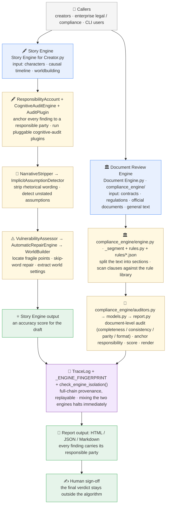

<p align="center">
  
</p>

<p align="center">
  
  
  
  
  
</p>

<blockquote align="center">
  <em>One repo · two engines — Story Engine and Document Review Engine</em>
</blockquote>

<p align="center">
  <a href="README-zh.md">简体中文</a> | English
</p>

<div style="max-width:880px;margin:0 auto;padding:0 16px">

## ✦ About

<p style="font-size:15px;line-height:1.8;color:#2C2C2C">STORY-ENGINE is <strong>two engines in one repository</strong> — independent, runnable on their own, sharing one deterministic audit grammar:</p>

<ul style="font-size:15px;line-height:1.8;color:#2C2C2C">
  <li><strong>Story Engine</strong> — a long-form novel consistency engine for creators and the general public. It automatically audits character settings, causal timelines, and memory lines, keeping million-word works consistent in characters, plot, and worldview; it also provides the SPL four-stage narrative editing pipeline. It transforms an editor's intuitive verification into a reusable structured process.</li>
  <li><strong>Document Review Engine</strong> — a document review engine for enterprise legal and compliance teams. It performs clause-level rule scanning and document-level auditing (element completeness / consistency / rights-obligation parity / formatting) on contracts, regulations, official documents, and general text, and outputs traceable review reports. <strong>The rule kernel is zero-dependency and fully offline-capable</strong>; `Document Engine.py` provides an optional LLM-enhancement entry point.</li>
</ul>

<p align="center">
  
</p>

</div>

<p align="center">— ✦ —</p>

## ✦ Architecture (Plain Language)

> **In one sentence:** one repo, two engines — one keeps a million-word novel from contradicting itself, the other keeps enterprise documents compliant. Both share the same audit grammar, while their data classes are isolated from each other.



**How to read this diagram**

1. **Top to bottom: two entries, one spine.** Callers enter either the Story Engine branch or the Document Review Engine branch; both converge on the same provenance layer and emit the same three report formats.
2. **Every box names a real file or class.** `Story Engine for Creator.py`, `Document Engine.py`, `compliance_engine/engine.py`, `auditors.py`, `models.py`, `report.py` — check them against the source directly.
3. **The Document Review Engine is the hardest boundary.** Its rule kernel uses no model at all: a pure JSON rule library (`rules/*.json`), offline-capable, deterministic on a hit. `Document Engine.py` is only an optional LLM-enhancement layer — the engine runs complete without it.

📖 Every term explained in one plain sentence → [Glossary](./GLOSSARY.md)

## ✦ Design Direction

<div style="max-width:880px;margin:0 auto;padding:0 16px">

One repository, two engines, each aimed at a different audience:

| Engine | Audience | Modules | Typical input |
|---|---|---|---|
| **Story Engine** | Creators / general public | `Story Engine for Creator.py` · `prose_bridge.py` · `shuihu_llm_audit.py` | characters / causal timeline / worldbuilding / narrative elements |
| **Document Review Engine** | Enterprise legal / compliance | `compliance_engine/` (rule kernel, offline, zero-dependency) + `Document Engine.py` (optional LLM enhancement) | contracts / regulations / official documents / general text |

Both engines share one **deterministic audit design language** — accountability anchoring (`ResponsibilityAccount`), risk grading, and a fully traceable log. The Document Review Engine's rule kernel **does not depend on an LLM** — pure rule library, zero third-party dependencies, offline-capable, built for enterprise document compliance.

</div>

<p align="center">— ✦ —</p>

## ✦ Quick Start

```bash
# Primary: GitHub
git clone https://github.com/nohn3043-arch/story-engine.git
# Mirror: Gitee
# git clone https://gitee.com/sjiun/Story-engine.git
cd Story-engine
# Pure Python >= 3.8. Engine files deliberately use space-separated names.

# ── Engine one: Story Engine ──
python "Story Engine for Creator.py"      # long-form narrative consistency audit

# ── Engine two: Document Review Engine ──
python -m compliance_engine audit --type contract --input contract.txt --output report.html
python -m compliance_engine audit --type regulation --input policy.txt --format json
python -m compliance_engine list-rules --type contract
python -m compliance_engine demo
```

<p align="center">— ✦ —</p>

## ✦ Features

<div style="max-width:880px;margin:0 auto;padding:0 16px">

One repository, two engines, each serving a different audience:

### Engine one · Story Engine (for creators and the general public)

A long-form novel consistency engine that turns an editor's intuitive verification into a reusable structured process:

- **Creator engine** (`Story Engine for Creator.py`) — the narrative-facing cognitive audit layer:
  - `ResponsibilityAccount` — every check is anchored to a named accountable node (who / role / stage).
  - `CognitiveAuditEngine` + pluggable `AuditPlugin` + `EmotionalConstraint` — composable audit dimensions.
  - `CausalNode` carries `implicit_assumptions` and `vulnerability_score` — tracks *because → therefore* logic and quantifies fragility.
  - `NarrativeStripper` / `ImplicitAssumptionDetector` / `VulnerabilityAssessor` — the second-perspective operator pipeline.
  - `AutomaticRepairEngine` (full skip-word repair) / `UltimateCausalNovelEngine` / `SecondPerspectiveCausalEngine` / `WorldBuilder` (token-level worldview extraction) — repair, whole-book audit, and worldbuilding layers.
- **Prose bridge** (`prose_bridge.py`) and **corpus audit** (`corpus_fetch.py` / `corpus_audit_report.py` / `shuihu_llm_audit.py`) — generation and bulk corpus verification layers.

### Engine two · Document Review Engine (for enterprise legal / compliance)

An enterprise document compliance review engine in two parts:

- **Rule kernel** (`compliance_engine/`) — zero-dependency, offline:
  - Clause-level rule scanning plus document-level auditing (element completeness / consistency / rights-obligation parity / formatting) across four document types (contract / regulation / official document / general text).
  - `ComplianceEngine` orchestrates: segment → rule scan → document audit → accountability close → score → report.
  - `ResponsibilityAccount` accountability anchoring + `TraceLog` full-chain provenance; verdicts are deterministic (a hit decides), with no probabilistic output.
  - `RuleEngine` loads a pure JSON rule library (extensible via `--rules-dir`); four `Auditor` classes add clause-level hits.
  - Reports in three formats: HTML (visual) / JSON (structured) / Markdown (archival); full CLI: `audit` / `list-rules` / `demo`.
- **LLM enhancement entry** (`Document Engine.py`) — optional layer:
  - Defines the `LLMProvider` protocol; any class implementing it can be injected into the engine.
  - Ships `OpenAIProvider`: calls OpenAI-compatible endpoints (`gpt-4o` / `deepseek-chat`, etc.) via `urllib`, **zero external dependencies**.
  - With no LLM configured, the rule kernel runs complete on its own.

Both engines share one deterministic audit design language (accountability anchoring, risk grading, full-chain provenance) while serving narrative creation and enterprise document compliance respectively.

**Robustness hardening (fixed 2026-08)**:

- **Name plausibility filtering** — `_extract_plausible_name` excludes pronouns / verb phrases / weather-scene words; absence is preferred over noise: `"坚持己见" → ""`, `"他说：我们走吧" → ""`, `"林夏在评审会上坚持自研方案" → "林夏"`.
- **Token-level worldview extraction** — `WorldBuilder` pre-tokenizes on connectives and punctuation, then matches whole words with longest-suffix priority: `"青云宗与魔道势力在苍云大陆" → factions ["青云宗","魔道势力"], geography ["苍云大陆"]` — connectives are no longer swallowed.
- **Full-text revision replacement** — `AutomaticRepairEngine` replaces all stiff transition words (`突然 / 莫名 / 鬼使神差 …`) at once and merges adjacent duplicate transitions.
- **Engine isolation detection** — both engines embed `_ENGINE_FINGERPRINT` and `check_engine_isolation()`: mixing them in one process raises an immediate warning, preventing same-named but heterogeneous data classes (`CausalNode` / `ResponsibilityAccount`, etc.) from overwriting each other and corrupting or crashing the run.

</div>

<p align="center">— ✦ —</p>

## ✦ Usage

<div style="max-width:880px;margin:0 auto;padding:0 16px">

The Document Review Engine's rule kernel can be used directly as a library:

```python
from compliance_engine.engine import ComplianceEngine
from compliance_engine.models import DocType
from compliance_engine.report import to_html, to_json, to_markdown

engine = ComplianceEngine()                      # loads built-in rules/*.json by default
report = engine.audit(open("contract.txt", encoding="utf-8").read(), DocType.CONTRACT, title="Purchase Agreement")
print(to_json(report))
```

An external rule library can be swapped in with `ComplianceEngine(rules_dir=Path("my-rules"))`, or `--rules-dir` from the CLI.

When LLM enhancement is wanted, implement the `LLMProvider` protocol from `Document Engine.py` and inject it; without it the engine runs fully offline.

</div>

<p align="center">— ✦ —</p>

## ✦ Project Structure

```
STORY-ENGINE/
├── Story Engine for Creator.py    # Engine one · Story Engine (long-form narrative consistency audit)
├── prose_bridge.py                # prose bridge / generation layer
├── shuihu_llm_audit.py            # corpus audit (LLM-assisted)
├── corpus_fetch.py                # corpus fetching
├── corpus_audit_report.py         # corpus audit report
├── shuihu_builtin_audit_sample.md # built-in audit sample
├── Document Engine.py             # Engine two · LLM enhancement entry (LLMProvider protocol + OpenAIProvider)
├── compliance_engine/             # Engine two · rule kernel (offline, zero-dependency)
│   ├── engine.py / models.py / auditors.py / rules.py / report.py
│   ├── cli.py                     # audit / list-rules / demo
│   ├── rules/                     # contract.json / regulation.json / official_doc.json / common.json
│   └── demo.py
├── assets/                        # banner.svg/png, overview.svg/png
├── GLOSSARY.md                    # glossary
└── LICENSE
```

<p align="center">— ✦ —</p>

## ✦ License & Authorization

This repository is <strong>not open source</strong>. Dual-track model: free for personal non-commercial research; government / enterprise use requires a paid commercial license. See [LICENSE](./LICENSE).

| User | Purpose | License requirement |
|---|---|---|
| Individual (natural person) | Non-commercial academic research / study / personal experiments | **Free** under [LICENSE](./LICENSE) "Personal Free Research License" |
| Government agency / public institution / enterprise | Any purpose (including internal deployment, product development, service provision) | **Paid commercial license required in advance** |

- **Individual researchers** may use it free for non-commercial research, but may not use it for any commercial purpose, nor provide services to any enterprise or government agency.
- **Government / enterprise users** may not copy, deploy, run, integrate, or distribute this work before signing a commercial license agreement and paying the agreed fee.
- **Apply for a license**: International / Global — [ai@nohnlins.com](mailto:ai@nohnlins.com) · China — [lin@secondai.top](mailto:lin@secondai.top)

The licensor, applicable law, and dispute resolution are determined by the user's location per [LICENSE](./LICENSE): users within China → Shanghai Linming Junhua Technology Co., Ltd. (PRC law); users outside China → NOHN AI TECHNOLOGY PTE. LTD. (Singapore law, SIAC arbitration).

<p align="center">
  <a href="https://github.com/nohn3043-arch">GitHub</a>
  &nbsp;·&nbsp;
  <a href="https://www.nohnlins.com/">nohnlins.com</a>
  &nbsp;·&nbsp;
  <a href="mailto:ai@nohnlins.com">ai@nohnlins.com</a>
</p>
<p align="center"><sub>NOHN AI · STORY-ENGINE (Story Engine · Document Review Engine)</sub></p>
