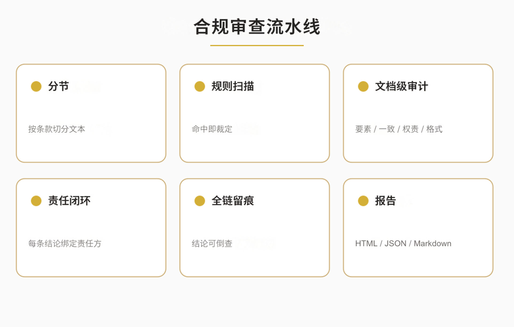
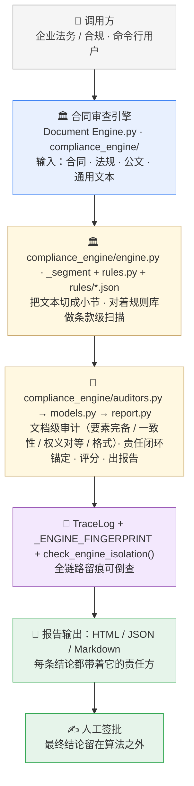

<p align="center">
  
</p>

<p align="center">
  
  
  
  
  
</p>

<blockquote align="center">
  <em>一个仓库 · 一个引擎 —— 合同审查引擎</em>
</blockquote>

<p align="center">
  <a href="README.md">English</a> | 简体中文
</p>

<div style="max-width:880px;margin:0 auto;padding:0 16px">

## ✦ 关于

<p style="font-size:15px;line-height:1.8;color:#2C2C2C">STORY-ENGINE 现在<strong>只提供一个引擎</strong>，共用同一套确定性审计语法：</p>

<ul style="font-size:15px;line-height:1.8;color:#2C2C2C">
  <li><strong>合同审查引擎（Document Review Engine）</strong> —— 面向企业法务 / 合规的文档复核引擎。对合同、法规、公文与通用文本执行条款级规则扫描与文档级审计（要素完整性 / 一致性 / 权责对等 / 格式），并输出可追溯的复核报告。<strong>规则内核零依赖、可完全离线运行</strong>；`Document Engine.py` 提供可选的 LLM 增强入口。</li>
</ul>

<p align="center">
  
</p>

</div>

<p align="center">— ✦ —</p>

## ✦ 系统架构（人话版）

> **一句话：** 一个仓库，一个引擎——让企业文档保持合规，每条结论都能倒查到责任方。



**这张图怎么看**

1. **从上往下：一个入口，一条脊柱。** 调用方进入合同审查引擎，一路汇入留痕层，产出三种格式的报告。
2. **每个框都写了真实文件或类名。** `Document Engine.py`、`compliance_engine/engine.py`、`auditors.py`、`models.py`、`report.py`——可以对照源码直接翻。
3. **合同审查引擎是最硬的边界。** 它的规则内核完全不依赖大模型：纯 JSON 规则库（`rules/*.json`），可离线运行，命中即判、结果确定。`Document Engine.py` 只是可选的 LLM 增强层，不接入也能完整跑通。

📖 每个术语都用一句人话解释 → [术语表 GLOSSARY](./GLOSSARY.md)

## ✦ 设计方向

<div style="max-width:880px;margin:0 auto;padding:0 16px">

一个仓库，一个引擎：

| 引擎 | 目标用户 | 模块 | 典型输入 |
|---|---|---|---|
| **合同审查引擎** | 企业法务 / 合规 | `compliance_engine/`（规则内核，离线零依赖）+ `Document Engine.py`（可选 LLM 增强） | 合同 / 法规 / 公文 / 通用文本 |

它沿用**确定性审计设计语言** —— 责任闭环锚定（`ResponsibilityAccount`）、风险分级与全链可追溯日志。规则内核**不依赖 LLM** —— 纯规则库、零第三方依赖、离线运行，专攻企业文档合规场景。

</div>

<p align="center">— ✦ —</p>

## ✦ 快速开始

```bash
# 主仓库：GitHub
git clone https://github.com/nohn3043-arch/story-engine.git
# 镜像：Gitee
# git clone https://gitee.com/sjiun/Story-engine.git
cd story-engine/document-engine    # GitHub 克隆目录为 story-engine，Gitee 为 Story-engine
# 纯 Python >=3.8

python -m compliance_engine audit --type contract --input 合同.txt --output 报告.html
python -m compliance_engine audit --type regulation --input 制度.txt --format json
python -m compliance_engine list-rules --type contract
python -m compliance_engine demo
```

<p align="center">— ✦ —</p>

## ✦ 功能特性

<div style="max-width:880px;margin:0 auto;padding:0 16px">

一个仓库，一个引擎：

### 合同审查引擎（面向企业法务 / 合规）

一款企业级文档合规复核引擎，由两部分组成：

- **规则内核**（`compliance_engine/`）—— 零依赖、离线运行：
  - 支持对四类文档（合同 / 法规 / 公文 / 通用文本）执行条款级规则扫描 + 文档级审计（要素完整性 / 一致性 / 权责对等 / 格式）。
  - `ComplianceEngine` 编排：分节 → 规则扫描 → 文档级审计 → 责任闭环 → 评分 → 报告。
  - `ResponsibilityAccount` 责任闭环锚定 + `TraceLog` 全链可追溯；判定为确定性（命中即裁定），无概率输出。
  - `RuleEngine` 加载纯 JSON 规则库（可经 `--rules-dir` 外部扩展）；四个 `Auditor` 类补充条款级命中。
  - 报告支持三种格式：HTML（可视化）/ JSON（结构化）/ Markdown（归档）；完整 CLI：`audit` / `list-rules` / `demo`。
- **LLM 增强入口**（`Document Engine.py`）—— 可选层：
  - 定义 `LLMProvider` 协议，任何实现该协议的类都可注入引擎。
  - 自带 `OpenAIProvider`：用 `urllib` 调用 OpenAI 兼容接口（`gpt-4o` / `deepseek-chat` 等），**零外部依赖**。
  - 不配置任何 LLM 时，规则内核独立完整运行。
- **英文规则库**（`compliance_engine/rules/en/`）—— 与中文规则逐条对齐（同一规则 ID，英文关键词 / 正则表达），共 14 条，覆盖合同 / 法规 / 公文 / 通用四类。语言默认按文本中英文占比自动判定，也可用 `--lang en` / `--lang zh` 显式指定；要素清单（目的 / 适用范围 / 职责 / 流程 / 罚则 / 生效等）同样有英文版，英文文档不再因“中文词不存在”而误判缺失。中文路径行为不变。

```bash
python -m compliance_engine audit --type regulation --input policy.txt --lang en --format json
python -m compliance_engine list-rules --lang en   # 列出英文规则库（14 条）
```

引擎延用同一套确定性审计设计语言（责任闭环锚定、风险分级、全链可追溯），面向企业文档场景。

**健壮性加固**：

- **引擎隔离检测** —— 内嵌 `_ENGINE_FINGERPRINT` 与 `check_engine_isolation()`：与同名但异质的数据类（`ResponsibilityAccount` 等）在同一进程中混用会立即告警，防止互相覆盖导致的数据损坏。

</div>

<p align="center">— ✦ —</p>

## ✦ 使用方法

<div style="max-width:880px;margin:0 auto;padding:0 16px">

合同审查引擎的规则内核可直接以库方式调用：

```python
from compliance_engine.engine import ComplianceEngine
from compliance_engine.models import DocType
from compliance_engine.report import to_html, to_json, to_markdown

engine = ComplianceEngine()                      # 默认加载内置 rules/*.json
report = engine.audit(open("合同.txt", encoding="utf-8").read(), DocType.CONTRACT, title="采购合同")
print(to_json(report))
```

也可以换外部规则库：`ComplianceEngine(rules_dir=Path("my-rules"))`，或用 `--rules-dir` 从 CLI 指定。

需要 LLM 增强时，实现 `Document Engine.py` 里的 `LLMProvider` 协议并注入即可；不注入则完全离线运行。

</div>

<p align="center">— ✦ —</p>

## ✦ 项目结构

```
document-engine/
├── document-engine/               # 合同审查引擎
│   ├── Document Engine.py         # LLM 增强入口（LLMProvider 协议 + OpenAIProvider）
│   ├── compliance_engine/         # 规则内核（离线、零依赖）
│   │   ├── engine.py / models.py / auditors.py / rules.py / report.py
│   │   ├── cli.py                 # audit / list-rules / demo
│   │   ├── rules/                 # contract.json / regulation.json / official_doc.json / common.json
│   │   └── demo.py
│   └── demo_output/               # 演示产物（git 忽略）
├── assets/                        # banner.svg/png、overview.svg/png
├── GLOSSARY.md                    # 术语表
├── LICENSE
└── README.md
```

<p align="center">— ✦ —</p>

## ✦ 许可与授权

本仓库**并非开源**，采用双轨模式：个人非商业研究免费；政府 / 企业需付费商业许可。详见 [LICENSE](./LICENSE)。

| 使用者 | 用途 | 许可要求 |
|---|---|---|
| 个人（自然人） | 非商业学术研究 / 学习 / 个人实验 | 依 [LICENSE](./LICENSE) "个人免费研究许可"，**免费** |
| 政府机构 / 公共事业单位 / 企业 | 任何用途（含内部部署、产品开发、对外服务） | **须事先取得付费商业许可** |

- **个人研究者**可免费用于非商业研究，但不得用于任何商业用途，也不得向任何企业或政府机构提供服务。
- **政府 / 企业用户**在签署商业许可协议并支付约定费用之前，不得复制、部署、运行、集成或分发本作品。
- **申请许可**：国际 / 全球 —— [ai@nohnlins.com](mailto:ai@nohnlins.com) · 中国 —— [lin@secondai.top](mailto:lin@secondai.top)

许可方、适用法律与争议解决依 [LICENSE](./LICENSE) 按用户所在地确定：中国境内用户 → 上海霖铭均华科技有限公司（中国法律）；中国境外用户 → NOHN AI TECHNOLOGY PTE. LTD.（新加坡法律，SIAC 仲裁）。

<p align="center">
  <a href="https://github.com/nohn3043-arch">GitHub</a>
  &nbsp;·&nbsp;
  <a href="https://www.nohnlins.com/">nohnlins.com</a>
  &nbsp;·&nbsp;
  <a href="mailto:ai@nohnlins.com">ai@nohnlins.com</a>
</p>
<p align="center"><sub>NOHN AI · STORY-ENGINE（合同审查引擎）</sub></p>
